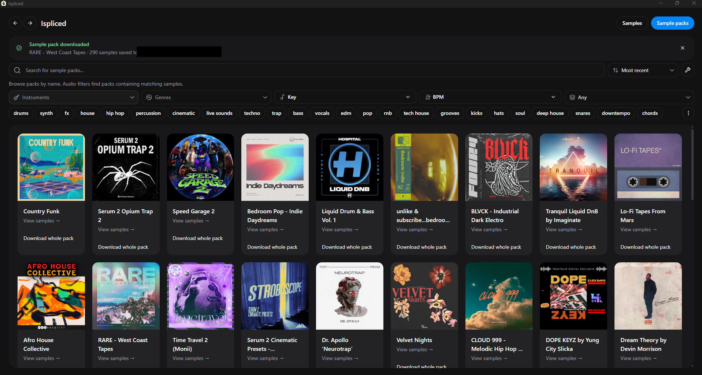

#  Ispliced

**Ispliced** is a desktop sample browser based on
[Splicedd by ascpixi](https://github.com/ascpixi/splicedd). It keeps the original
sample search, audio previews and DAW drag-and-drop, and adds artwork-based pack
browsing, whole-pack downloads and navigation history.

[Releases](https://github.com/mackiediablo-art/Ispliced/releases) ·
[Windows builds](https://github.com/mackiediablo-art/Ispliced/actions/workflows/windows-build.yml) ·
[Original project](https://github.com/ascpixi/splicedd)



## Original features

These features were already present in the Splicedd checkout used to start this
fork, commit [`15db3b6`](https://github.com/mackiediablo-art/Ispliced/commit/15db3b65e599172dcc18a0828c0de2f546e1db4d):

- **Sample search:** search the Splice sample catalogue without an in-app sign-in.
- **Search filters:** instruments, genres, tags, musical key and major/minor
  scale, exact BPM or BPM range, and one-shot/loop sample types.
- **Sorting and pagination:** relevance, popularity, recency and random ordering,
  with multiple pages of sample results.
- **Audio previews:** play/stop controls, interactive waveform seeking, and sample
  metadata including key, tempo and duration.
- **DAW drag-and-drop:** download and decode individual sample previews, export
  WAV files to a chosen sample folder and drag them into another application.
- **Pack context:** show pack artwork with a sample and click it to filter the
  sample list to that pack.
- **Export settings:** optional placeholder files for dragging before a download
  finishes, MP3 delay trimming, and Windows path-length handling.
- **Desktop preferences:** configurable sample folder, dark/light appearance,
  saved settings and missing-folder warnings.
- **Update support:** release checks, update notifications, changelogs and
  platform-specific installer handling.
- **Development and packaging:** React/Vite browser development with mock samples,
  a Tauri/Rust desktop shell, and Windows, macOS and Linux release builds.

## New features added in Ispliced

These additions were made after cloning the original repository:

- **Ispliced branding:** updated application and window names, README branding,
  package names and release bundle filenames. The existing application identifier
  is retained so saved settings remain available.
- **Sample packs tab:** a dedicated artwork grid with pack-name search. The
  sample search filters and sorting controls are also available when finding packs.
- **Pack-to-sample navigation:** open a pack to browse all of its samples,
  with pagination, then return to the pack search with its filters restored.
- **Faster pack filtering:** return the first matching sample page without waiting
  for a catalogue-wide scan. **Load more packs** discovers additional packs on
  demand and removes duplicates. Session caches reuse results, and duplicate
  helper requests are consolidated.
- **Back/forward arrows:** restore the previous view, search, filters, pagination
  and scroll position. History lasts for the current application session.
- **24-bit WAV exports:** individual sample drag-and-drop and whole-pack downloads
  now export 24-bit PCM WAV files instead of 16-bit, retaining the decoded sample
  rate and the configured MP3 delay trimming.
- **Whole-pack downloads:** save every sample across every page of a pack as
  24-bit WAV files under the configured sample folder, regardless of browse filters.
- **Persistent download notifications:** show **Downloading sample pack** while
  work is in progress and **Sample pack downloaded** only after every file has
  been saved. Progress remains visible while navigating between views; failed
  or partial downloads show an error instead of a success message.
- **Controlled batch exports:** process up to two samples concurrently, skip
  repeated sample IDs, keep conflicting filenames separate, and support audio
  longer than one minute when exporting a pack.
- **Complete desktop shutdown:** closing the main window also exits the hidden
  Splice search webview so the application does not remain running in Task Manager.
- **Visual Studio 2026 builds:** commands for a Windows x64 application executable
  or an NSIS `.exe` installer, with automatic discovery of the VS 2026 C++ tools.
- **Manual Windows builds on GitHub:** a workflow that uploads the executable
  and installer as downloadable artifacts without publishing a release.
- **Automated checks:** unit tests for search, pack pagination, downloads, WAV
  conversion, navigation and build commands, plus browser tests for the UI.

## Browse samples and packs

Use **Samples** to search individual sounds or **Sample packs** to browse pack
artwork and search by pack name. Audio filters on the packs tab find packs
containing matching samples. If more matching sample pages remain, choose
**Load more packs** to continue discovering packs. A name search with audio
filters may need more pages before the desired pack appears.

Click a pack to open its complete sample list. Discovery filters are cleared
when opening it so all its samples are available. **Back to packs** restores the
search used to find it. The arrows at the top move backward and forward through
browse history; starting a new search after going back replaces forward history.

## Download a whole pack

1. Choose an existing **Sample folder** in Settings.
2. Select **Download whole pack** on a pack card or in an open pack's header.
3. Keep the application open while **Downloading sample pack** is displayed.
4. Wait for **Sample pack downloaded**, which confirms all samples have been saved.

Files are saved in a pack subfolder. Exports use the same decoded preview audio
as individual drag-and-drop exports, converted to 24-bit WAV with the configured
MP3 delay trimming. They are not a download of the original source WAV masters.

Only one whole-pack job runs at a time, with at most two audio downloads/conversions
in flight. If a sample or request fails, the notification reports the failure.
You can retry the pack; files at the same export paths are replaced. Browser
mock mode does not download audio or write files.

## Development

Install [Node.js](https://nodejs.org/) (22 LTS or newer), Yarn Classic and
[the Tauri prerequisites](https://v2.tauri.app/start/prerequisites/) for your
platform. The desktop shell also needs Rust through [rustup](https://rustup.rs/).

```sh
npm install --global yarn@1.22.22
yarn install --frozen-lockfile
yarn dev
```

`yarn dev` starts the browser UI with mock samples and pack artwork. For real
sample playback, downloads and native drag-and-drop, start the desktop shell:

```sh
yarn tauri dev
```

| Command | Purpose |
| --- | --- |
| `yarn build` | TypeScript checking and production frontend build |
| `yarn test` | Unit tests |
| `yarn test:browser` | Browser tests for navigation, filtering and download notifications |
| `npm run build:windows` | Windows application executable and NSIS installer |
| `npm run build:exe` | Windows application executable only |

For browser tests, install Chromium with `yarn playwright install chromium`,
or set `CHROMIUM_PATH` to an existing Chromium executable.

## Compile a Windows executable (Visual Studio 2026)

Build on Windows. In **Visual Studio Installer → Visual Studio 2026 → Modify**,
install **Desktop development with C++**, including the MSVC x64/x86 build tools
and a Windows 10 or Windows 11 SDK. The full IDE or Build Tools edition works;
this is a Tauri/Rust project, so no Visual Studio solution file is needed.

Install [Node.js](https://nodejs.org/) (22 LTS or newer),
[Rust through rustup](https://rustup.rs/), and the
[Microsoft Edge WebView2 Runtime](https://developer.microsoft.com/microsoft-edge/webview2/).
Open PowerShell or a terminal in the repository directory and prepare the tools:

```powershell
npm install --global yarn@1.22.22
rustup toolchain install stable-x86_64-pc-windows-msvc --profile minimal
```

Compile the application and an `.exe` installer:

```powershell
npm run build:windows
```

Or compile just the application `.exe`:

```powershell
npm run build:exe
```

Both commands discover Visual Studio **2026 (version 18)** using `vswhere`, activate
its x64 C++ environment, install the locked JavaScript dependencies and compile
the frontend and Rust application in release mode. They use the MSVC Rust
toolchain and keep build outputs inside `src-tauri/target`, even when
`CARGO_TARGET_DIR` is set in your terminal.

| Output | Location |
| --- | --- |
| Application | `src-tauri/target/x86_64-pc-windows-msvc/release/ispliced.exe` |
| Installer | `src-tauri/target/x86_64-pc-windows-msvc/release/bundle/nsis/*-setup.exe` |

The application executable requires WebView2 on the destination computer. Use
the NSIS installer for distribution; it handles WebView2 installation when
needed. Initial builds need Internet access for dependencies and installer
tools. Builds are unsigned unless you configure Windows code signing.

If the launcher cannot find Visual Studio, repair or enable the C++ workload in
Visual Studio Installer. If Rust cannot locate the compiler/linker, update the
MSVC toolchain with the `rustup toolchain install` command above and retry.

### Build on GitHub instead

Open [Actions → Windows executable](https://github.com/mackiediablo-art/Ispliced/actions/workflows/windows-build.yml),
choose **Run workflow**, and select your branch. After it succeeds, download
**Ispliced-windows-x64-exe** or **Ispliced-windows-x64-installer** from the run's
artifacts and extract the ZIP. This build uses the hosted Windows runner's C++
toolchain; it does not require Visual Studio on your computer and does not
publish a release.

## macOS

Ispliced is not notarized by Apple. If macOS blocks the application, open
**System Settings → Privacy & Security** and select **Open Anyway** for Ispliced,
or run:

```sh
xattr -dr com.apple.quarantine /Applications/Ispliced.app
```

## Credits and license

Original application: [Splicedd](https://github.com/ascpixi/splicedd) by
[ascpixi](https://github.com/ascpixi). The original sample browser, audio workflow
and desktop foundation are credited above; Ispliced's additions are listed
separately under **New features added in Ispliced**.

Ispliced is distributed under the [GNU General Public License v3.0](./LICENSE).

<details>
<summary>Original Splicedd preview</summary>


[Original basic demo](https://github.com/ascpixi/splicedd/assets/44982772/4406e3a2-1361-4198-baf9-cca5b4fb62af) ·
[Original drum loop demo](https://github.com/ascpixi/splicedd/assets/44982772/02dda4ce-d61c-4240-8759-bbd18c31de24)

</details>
